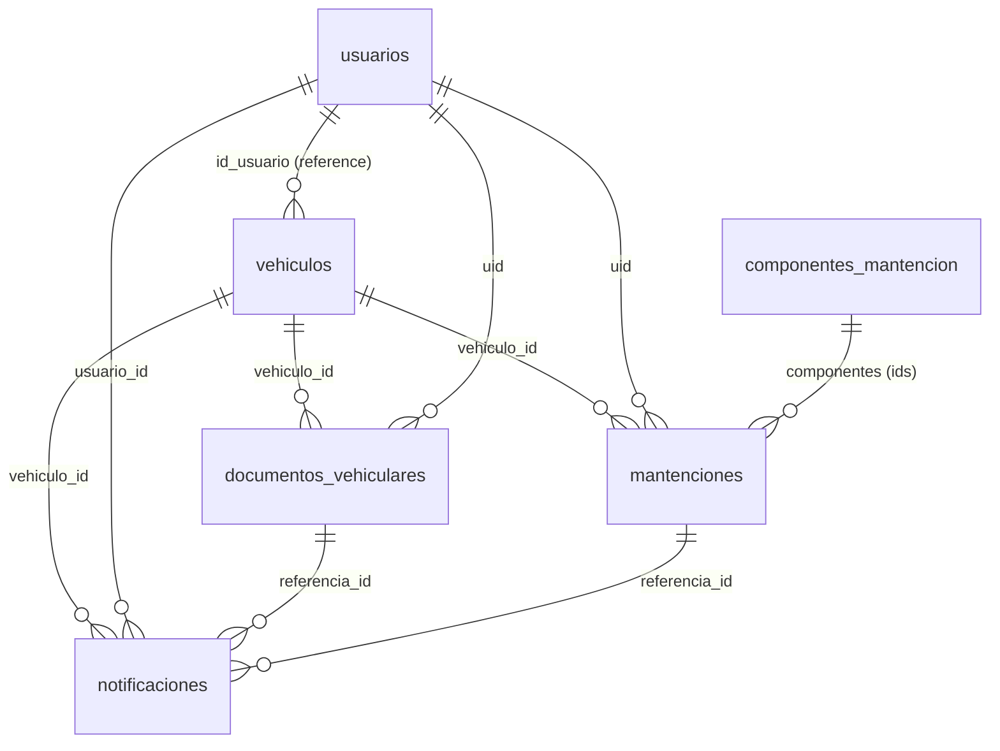

# Informe de Arquitectura de Datos - TAG OK Fase 2

Estructura de la base de datos de la **Fase 2 (TAG OK 2.0)** en **Google Firebase (Cloud Firestore)**, proyecto `tag-ok-v2`. Este documento complementa a `DOCUMENTACION_BASE_DE_DATOS.md` (que cubre todo el sistema) y describe solo lo que construyó el equipo de la Fase 2: Mi Vehículo, Registro Inteligente con IA, Mantenciones y Notificaciones.

Firestore es NoSQL: **no hay un script SQL de creación**. Las colecciones se crean solas cuando la app escribe el primer documento. Lo que fija la estructura y las validaciones es `Producto/tag_ok/firestore.rules` (fuente oficial; no editar las reglas en la consola). Los campos, largos y enumeraciones de este documento se tomaron de `DOCUMENTACION_BASE_DE_DATOS.md`, que a su vez se generó desde esas reglas.

## 1. Alcance de la Fase 2 en la base de datos

| Módulo de la Fase 2 | Estado en Firestore | Colección |
|---|---|---|
| Mi Vehículo (vehículos y documentos) | Implementado | `vehiculos` (compartida con la Fase 1), `documentos_vehiculares` |
| Registro Inteligente con IA | Implementado (transversal) | Escribe en `documentos_vehiculares` y `mantenciones` (`origen_registro`, `confianza_ia`) |
| Mantenciones | Implementado | `mantenciones`, `componentes_mantencion` |
| Notificaciones | Implementado para vencimientos y mantenciones | `notificaciones` |
| Estacionamientos | **Planificado (Sprint 4); sin reglas aún** | `estacionamientos` |
| Combustible y carga | **Planificado (Sprint 4); sin reglas aún** | `abastecimientos` |
| Beneficios | **Planificado (Sprint 5); sin reglas aún** | `beneficios` |
| Dashboard "Mi Auto" | Sin colección propia: consolida las anteriores | — |

Todo lo que no figura en las reglas está denegado, así que las colecciones planificadas no se pueden usar hasta agregar sus reglas.

## 2. Mapa de colecciones



| Colección | Qué guarda | Quién escribe |
|---|---|---|
| `vehiculos/{id}` | Vehículos registrados (compartida con la Fase 1) | Su dueño |
| `documentos_vehiculares/{id}` | Permiso de circulación, revisión técnica, SOAP, seguro | Su dueño |
| `mantenciones/{id}` | Mantenciones realizadas o programadas | Su dueño |
| `componentes_mantencion/{id}` | Catálogo de componentes de mantención | Solo admins |
| `notificaciones/{id}` | Recordatorios de vencimientos y mantenciones | Su dueño |

Las relaciones son por referencia (`vehiculo_id`, `uid`, `usuario_id`, `id_usuario`). Firestore no verifica claves foráneas: la integridad la controlan las reglas y el código.

## 3. Detalle por colección

Los campos marcados *(req)* son obligatorios. Los largos y rangos son los de las reglas.

### `vehiculos/{id}` (compartida con la Fase 1)
Se documenta aquí porque documentos y mantenciones se enlazan a ella.
- **id_usuario** *(req, inmutable)*: **Reference** a `usuarios/{uid}`.
- **patente** *(req, máx. 20)*: única por usuario.
- **categoria**, **marca**, **modelo**, **tipo_vehiculo**, **tipo_combustible**, **alias**, **estado**, **fecha_ingreso**: string.
- **foto_path**: string (máx. 500) | null. Ruta de la foto del vehículo; el archivo no está en Firestore.
- **anio**: entero (1900 a 2100) | **kilometraje_actual**: entero (0 a 10.000.000) | **fecha_registro**: timestamp.

### `documentos_vehiculares/{id}`
- **uid** *(req, inmutable)*: dueño | **vehiculo_id** *(req, inmutable)*.
- **tipo_documento**: `permiso_circulacion` | `revision_tecnica` | `soap` | `seguro`.
- **origen_registro**: `manual` | `ia` | **fecha_registro**: timestamp.
- **numero**, **compania**, **numero_poliza**, **archivo_path**: string | null. `archivo_path` es la ruta en Supabase Storage.
- **fecha_emision**, **fecha_vencimiento**, **fecha_captura**: timestamp | null.
- **forma_pago**: `total` | `cuota_1` | `cuota_2` | null (casilla marcada en el permiso).
- **fecha_emision_estimada**: bool, `true` si la emisión no figuraba y se completó con la fecha de ingreso.
- **confianza_ia**: número | null. Las reglas no fijan un rango (ver Observaciones).

### `mantenciones/{id}`
No se guarda la foto ni el PDF de la boleta: solo los datos extraídos y la referencia del comprobante.
- **uid** *(req, inmutable)*: dueño | **vehiculo_id** *(req, inmutable)*.
- **estado** *(req)*: `programada` (lleva `proxima_fecha` y/o `proximo_kilometraje`) | `realizada` (lleva `fecha`).
- **tipo** *(req, 1 a 60 caracteres)*: título de texto libre ("Cambio de aceite", "Revisión de 20.000 km"). Las mantenciones antiguas guardan un valor de la lista anterior (`cambio_aceite`, `revision_general`, `cambio_filtros`, `frenos`, `neumaticos`, `alineacion_balanceo`, `bateria`, `sistema_electrico`, `motor`, `preventiva`, `otra`); la app lo traduce al mostrarlo.
- **tipo_otro**: string | null, solo en antiguas con tipo `otra`.
- **fecha**, **proxima_fecha**, **fecha_captura**: timestamp | null.
- **kilometraje**, **proximo_kilometraje**: entero (0 a 5.000.000) | null.
- **costo**: entero en pesos (0 a 1.000.000.000) | null.
- **taller** (máx. 100), **descripcion** (máx. 500), **observaciones** (máx. 1.000): string | null. En registros con IA, `descripcion` lleva los ítems del detalle del documento separados por comas.
- **tipo_comprobante**: `boleta` | `factura` | `otro` | null | **numero_comprobante**: string (máx. 50) | null.
- **componentes**: lista de ids de `componentes_mantencion` (máximo 30). El formulario ya no los pide; las mantenciones antiguas conservan los suyos.
- **origen_registro** *(req)*: `manual` | `ia` | **confianza_ia**: número (0 a 100) | null.

### `componentes_mantencion/{id}`
Catálogo editable por admins. Si la colección está vacía, la app usa estos valores por defecto: `mantencion_general`, `cambio_aceite_motor`, `rotacion_neumaticos`, `frenos`, `filtro_aire`, `bateria`, `liquido_frenos`.
- **nombre** *(req)*: string | **orden** *(req)*: entero | **activo** *(req)*: bool.

### `notificaciones/{id}`
El id es `{documentoId}_30dias`, `_15dias` o `_7dias` para vencimientos de documentos, o el de la mantención para sus recordatorios. Como el id es determinístico, la app puede volver a escribir el mismo aviso sin duplicarlo.
- **usuario_id** *(req, inmutable)*: dueño | **vehiculo_id**, **tipo**, **referencia_id**, **mensaje**: string.
- **estado**: string (por defecto `pendiente`) | **leida**: bool.
- **fecha_programada**, **fecha_generacion**: timestamp.

## 4. Colecciones planificadas (diseño, aún sin reglas)

Estos campos vienen del Diccionario de Datos y del Modelo Relacional de la Fase 2. Al implementarlas hay que **agregar el campo `uid`** (dueño) y escribir las reglas, como en las demás colecciones, y probarlas en el emulador antes de publicarlas.

| Colección | Módulo | Campos de diseño |
|---|---|---|
| `estacionamientos/{id}` | Estacionamientos (Sprint 4) | `vehiculo_id`, `fecha`, `lugar`, `hora_entrada`, `hora_salida`, `duracion_min`, `costo`, `ubicacion` (GeoPoint), `observacion`, `estado`, `origen_registro`, `fecha_captura`, `confianza_ia` |
| `abastecimientos/{id}` | Combustible y carga (Sprint 4) | `vehiculo_id`, `fecha`, `kilometraje`, `estacion_servicio`, `tipo_abastecimiento`, `tipo_combustible`, `cantidad`, `unidad`, `precio_unitario`, `total`, `origen_registro`, `fecha_captura`, `confianza_ia` |
| `beneficios/{id}` | Beneficios (Sprint 5) | `categoria`, `titulo`, `descripcion`, `empresa` o `comercio`, `imagen_path`, `url_externa`, `ubicacion`, `fecha_inicio`, `fecha_fin`, `condiciones`, `destacado`, `activo` (catálogo global, sin referencia a usuario ni vehículo; lo administra el backoffice) |

Decisiones de diseño ya tomadas: no se guarda la foto de boletas ni tickets (solo los datos extraídos), el cronómetro de estacionamiento debe sobrevivir al cierre de la app (se guarda la hora de inicio en Firestore) y las ubicaciones usan GeoPoint.

## 5. Ejemplos de documentos

### `documentos_vehiculares` (permiso de circulación leído con IA)
```json
{
  "uid": "abc123",
  "vehiculo_id": "vehiculoDocId",
  "tipo_documento": "permiso_circulacion",
  "numero": "PC-2026-0001",
  "compania": "Municipalidad de Ejemplo",
  "fecha_emision": "2026-03-20",
  "fecha_vencimiento": "2027-03-31",
  "forma_pago": "total",
  "fecha_emision_estimada": false,
  "archivo_path": null,
  "origen_registro": "ia",
  "confianza_ia": 94
}
```

### `mantenciones` (realizada, desde una factura con IA)
```json
{
  "uid": "abc123",
  "vehiculo_id": "vehiculoDocId",
  "estado": "realizada",
  "tipo": "Cambio de aceite y filtro",
  "fecha": "2026-10-05",
  "kilometraje": 81900,
  "taller": "Taller Ejemplo",
  "costo": 87520,
  "descripcion": "Filtro de aceite, Aceite de motor, Mano de obra",
  "tipo_comprobante": "factura",
  "numero_comprobante": "F-000789",
  "componentes": [],
  "origen_registro": "ia",
  "confianza_ia": 88
}
```

### `mantenciones` (programada)
```json
{
  "uid": "abc123",
  "vehiculo_id": "vehiculoDocId",
  "estado": "programada",
  "tipo": "Cambio de aceite",
  "fecha": null,
  "proxima_fecha": "2027-02-23",
  "proximo_kilometraje": 91900,
  "origen_registro": "manual"
}
```

### `componentes_mantencion`
```json
{ "nombre": "Cambio de aceite de motor", "orden": 2, "activo": true }
```

### `notificaciones` (aviso a 7 días de un vencimiento)
Id: `{documentoId}_7dias`
```json
{
  "usuario_id": "abc123",
  "vehiculo_id": "vehiculoDocId",
  "tipo": "vencimiento_documento",
  "referencia_id": "documentoId",
  "mensaje": "Tu revisión técnica vence en 7 días",
  "estado": "pendiente",
  "leida": false
}
```

## 6. Población de datos de la Fase 2

El archivo `EXPORTACION_BASE_DE_DATOS_FASE2.json` tiene el mismo formato que `EXPORTACION_BASE_DE_DATOS.json` (`coleccion → idDocumento → datos`) y se carga con `seed-firestore.js`. Además de los datos incluye:
- `_esquema`: campos, tipos, obligatoriedad, largos, rangos y enumeraciones de las colecciones de la Fase 2, copiados de este documento. El script **valida contra este esquema antes de escribir**, porque el Admin SDK ignora las reglas de Firestore.
- `_meta`: las secciones disponibles y los marcadores de fecha, referencia y usuario.

| Sección | Se carga | Contenido |
|---|---|---|
| `base` | Por defecto | `administradores/{uid}`: el primer super_admin (si se define `SEED_ADMIN_UID`) |
| `catalogo` | Por defecto | `componentes_mantencion`: los 7 componentes por defecto |
| `demo` | Con `--con-demo` | 2 vehículos, 5 documentos, 5 mantenciones (4 realizadas y 1 programada) y 4 notificaciones, todos con id `seed_...` |

Los datos de ejemplo son ficticios (patentes `ZZTS12` y `ZZTS13`, talleres y compañías de ejemplo). Una revisión técnica vence 9 días después de la carga para que se vean las alertas.

Uso:
```powershell
npm install firebase-admin
$env:GOOGLE_APPLICATION_CREDENTIALS = "C:\ruta\fuera\del\repo\llave.json"
$env:SEED_OWNER_UID = "<uid de un usuario existente en Authentication>"
node seed-firestore.js                       # valida y simula
node seed-firestore.js --apply               # catálogo (y admin si se define)
node seed-firestore.js --apply --con-demo    # agrega los datos de ejemplo
```
Requisitos previos: base de datos creada, reglas publicadas y un usuario en Authentication. El script no sobrescribe documentos existentes, escribe solo en `tag-ok-v2` y `--clean --con-demo --apply` borra únicamente los documentos con id `seed_`.

## 7. Observaciones y diferencias a resolver

Al comparar la base real con el Diccionario de Datos y el Modelo Relacional de la Fase 2 quedan estas diferencias. Conviene actualizarlas en esos documentos o decidirlas antes del cierre.

1. **Escala de `confianza_ia`.** Las reglas de `mantenciones` exigen **0 a 100** y el ejemplo guarda 100. El Diccionario usa 0 a 1 (ejemplo 0,94) y las reglas de `documentos_vehiculares` no fijan rango. Hay que unificar y documentar una sola escala. Los datos de ejemplo usan 0 a 100.
2. **Dueño de `vehiculos`.** El modelo relacional dibuja `usuario_id` (texto); la base real usa `id_usuario` como **Reference** a `usuarios/{uid}`.
3. **Campos nuevos que el Diccionario no tiene.** En `mantenciones`: `estado`, `tipo_comprobante`, `numero_comprobante`, `componentes`, `tipo_otro` y el `tipo` como texto libre en lugar de lista. En `documentos_vehiculares`: `forma_pago` y `fecha_emision_estimada`. Todas llevan `uid`, que el modelo relacional no muestra.
4. **Catálogo nuevo.** `componentes_mantencion` no aparece en los modelos.
5. **Almacenamiento de archivos.** `archivo_path` y `foto_path` apuntan a **Supabase Storage**, no a Firebase Storage (como todavía indican algunos diagramas).
6. **Campo `estado` en `documentos_vehiculares`.** El modelo lógico lo incluía y la base real no lo documenta. Hay que confirmar con el código si se guarda o si el estado (vigente, por vencer, vencido) se calcula al mostrar el documento.
7. **Valores a validar contra el código** (se usaron en los datos de ejemplo): el formato de `fecha_ingreso` y los valores de `categoria` en `vehiculos`, y los valores de `tipo` y `estado` en `notificaciones`.

## 8. Mantener este documento

- La fuente de verdad de campos y validaciones es `Producto/tag_ok/firestore.rules` (comentario del encabezado y funciones `*Valida`).
- Al agregar o cambiar una colección o campo, hay que actualizar las reglas, probarlas en el emulador (`Producto/tag_ok/tools/rules_test`), este documento y el `_esquema` del JSON de población.
- Al implementar `estacionamientos`, `abastecimientos` o `beneficios`, mover su descripción desde la sección 4 a la sección 3.
- Las reglas se publican con `firebase deploy --only firestore:rules --project tag-ok-v2`.

---
*Documento de la Fase 2 construido a partir de `DOCUMENTACION_BASE_DE_DATOS.md` y del diseño de la Fase 2 - Octubre 2026*
