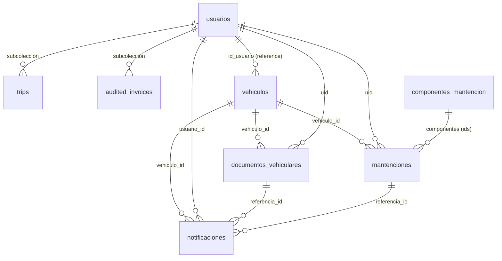

# Informe de Arquitectura de Datos - TAG OK

Estructura de la base de datos de TAG OK en **Google Firebase (Cloud Firestore)**, proyecto `tag-ok-v2`. Firestore es NoSQL: **no hay un script SQL de creación**. Las colecciones se crean solas cuando la app escribe el primer documento. Lo que fija la estructura y las validaciones es `Producto/tag_ok/firestore.rules` (fuente oficial; no editar las reglas en la consola).

Esta versión se actualizó desde `firestore.rules` y el código de `tag_ok` y `admin` (octubre 2026). Reemplaza la versión de mayo 2026, que solo describía cuatro colecciones.

## 1. Mapa de colecciones



| Colección | Qué guarda | Quién escribe |
|---|---|---|
| `usuarios/{uid}` | Perfil y presupuesto del conductor | El propio usuario |
| `usuarios/{uid}/trips/{id}` | Viajes finalizados | El propio usuario |
| `usuarios/{uid}/audited_invoices/{id}` | Facturas de autopista auditadas | El propio usuario |
| `vehiculos/{id}` | Vehículos registrados | Su dueño |
| `documentos_vehiculares/{id}` | Permiso de circulación, revisión técnica, SOAP, seguro | Su dueño |
| `mantenciones/{id}` | Mantenciones realizadas o programadas | Su dueño |
| `componentes_mantencion/{id}` | Catálogo de componentes | Solo admins |
| `notificaciones/{id}` | Recordatorios de vencimientos y mantenciones | Su dueño |
| `auditoria/{id}` | Bitácora de acciones (app y panel admin), solo creación | App y admin |
| `administradores/{uid}` | Quién es admin y su rol | Solo `super_admin` |
| `porticos/{id}` | Pórticos de cobro y tarifas por horario | Solo admins |
| `tarifas/{id}` | Datos de referencia de tarifas | Solo admins |
| `alertas/{id}` | Alertas del backoffice | Solo admins |

Todo lo que no figura arriba está denegado por las reglas.

## 2. Detalle por colección

Los campos marcados *(req)* son obligatorios. Los largos máximos son los de las reglas.

### `usuarios/{uid}`
El id del documento es el `uid` de FirebaseAuth. Contiene datos personales (email).
- **email** *(req, inmutable)*, **fecha_creacion** *(req, inmutable)*: timestamp.
- **nombre_mostrar**: string | null.
- **vehiculo_principal_id**: patente del vehículo principal | null.
- **limite_presupuesto_mensual**: número, tope de gasto mensual.
- **notif_cobros**, **notif_presupuesto**: bool, preferencias de avisos.
- **alertas_vistas**: mapa `string → bool` (por ejemplo `"2026-5_50": true`) para no repetir avisos de presupuesto.

#### Subcolección `trips/{id}`
Cada trayecto finalizado. El panel admin los lee todos con `collectionGroup('trips')`.
- **tolls**: lista de peajes cruzados (máximo 500) | **date**, **duration**: string (máximo 40) | **details**.

#### Subcolección `audited_invoices/{id}`
Facturas de autopista auditadas contra los viajes (pantalla de auditoría). Hasta 20 campos; `details` es una lista de hasta 2.000 ítems.

### `vehiculos/{id}`
- **id_usuario** *(req, inmutable)*: **Reference** a `usuarios/{uid}`.
- **patente** *(req, máx. 20)*: única por usuario.
- **categoria**, **marca**, **modelo**, **tipo_vehiculo**, **tipo_combustible**, **alias**, **estado**, **fecha_ingreso**: string.
- **foto_path**: string (máx. 500).
- **anio**: entero (1900 a 2100) | **kilometraje_actual**: entero (0 a 10.000.000) | **fecha_registro**: timestamp.

### `documentos_vehiculares/{id}`
- **uid** *(req, inmutable)*: dueño | **vehiculo_id** *(req, inmutable)*.
- **tipo_documento**: `permiso_circulacion` | `revision_tecnica` | `soap` | `seguro`.
- **origen_registro**: `manual` | `ia` | **fecha_registro**: timestamp.
- **numero**, **compania**, **numero_poliza**, **archivo_path**: string | null.
- **fecha_emision**, **fecha_vencimiento**, **fecha_captura**: timestamp | null.
- **forma_pago**: `total` | `cuota_1` | `cuota_2` | null (casilla marcada en el permiso).
- **fecha_emision_estimada**: bool, `true` si la emisión no figuraba y se completó con la fecha de ingreso.
- **confianza_ia**: número | null.

### `mantenciones/{id}`
No se guarda la foto ni el PDF de la boleta: solo los datos extraídos y la referencia del comprobante.
- **uid** *(req, inmutable)*: dueño | **vehiculo_id** *(req, inmutable)*.
- **estado** *(req)*: `programada` (lleva `proxima_fecha` y/o `proximo_kilometraje`) | `realizada` (lleva `fecha`).
- **tipo** *(req, 1 a 60 caracteres)*: **título de texto libre** ("Cambio de aceite", "Revisión de 20.000 km"). Las mantenciones antiguas guardan un valor de la lista anterior (`cambio_aceite`, `revision_general`, `cambio_filtros`, `frenos`, `neumaticos`, `alineacion_balanceo`, `bateria`, `sistema_electrico`, `motor`, `preventiva`, `otra`); la app lo traduce al mostrarlo.
- **tipo_otro**: string | null, solo en antiguas con tipo `otra`; las nuevas no lo usan.
- **fecha**, **proxima_fecha**, **fecha_captura**: timestamp | null.
- **kilometraje**, **proximo_kilometraje**: entero (0 a 5.000.000) | null.
- **costo**: entero en pesos (0 a 1.000.000.000) | null.
- **taller** (máx. 100), **descripcion** (máx. 500), **observaciones** (máx. 1.000): string | null. En registros con IA, `descripcion` lleva los ítems del detalle del documento separados por comas.
- **tipo_comprobante**: `boleta` | `factura` | `otro` | null | **numero_comprobante**: string (máx. 50) | null.
- **componentes**: lista de ids de `componentes_mantencion` (máximo 30). El formulario ya no los pide; las mantenciones antiguas conservan los suyos.
- **origen_registro** *(req)*: `manual` | `ia` | **confianza_ia**: número (0 a 100) | null.

### `componentes_mantencion/{id}`
Catálogo editable por admins. Si la colección está vacía, la app usa estos valores por defecto: `mantencion_general`, `cambio_aceite_motor`, `rotacion_neumaticos`, `frenos`, `filtro_aire`, `bateria`, `liquido_frenos`.
- **nombre** *(req)*: string | **orden** *(req)*: entero | **activo** *(req)*: bool.

### `notificaciones/{id}`
El id es `{documentoId}_30dias`, `_15dias` o `_7dias` para vencimientos de documentos, o el de la mantención para sus recordatorios.
- **usuario_id** *(req, inmutable)*: dueño | **vehiculo_id**, **tipo**, **referencia_id**, **mensaje**: string.
- **estado**: string (por defecto `pendiente`) | **leida**: bool.
- **fecha_programada**, **fecha_generacion**: timestamp.

### `auditoria/{id}`
Solo creación; dos formas.
- **App**: `usuario_id` (autor), `accion`, `tipo_entidad`, `entidad_id`, `detalle`, `origen`, `fecha`.
- **Panel admin**: `adminEmail`, `action`, `target`, `details`, `fecha`.

### `administradores/{uid}`
Un usuario es admin si existe un documento con su `uid`. Campos: **rol** *(req)*, por ejemplo `super_admin` u `operador`, y **email**. Solo `super_admin` crea, edita o borra, y nadie modifica su propio documento.

### `porticos/{id}`
Base maestra de puntos de cobro (exportación en `EXPORTACION_BASE_DE_DATOS.json`, 104 pórticos).
- **nombre**, **sentido** (por ejemplo `O-P`), **lat**, **lng**.
- **costo** (tarifa base), **costoPunta**, **costoSaturacion**.
- **fecha_actualizacion**.

### `tarifas/{id}` y `alertas/{id}`
Datos de referencia sin información personal. `tarifas` lo leen los usuarios con sesión; `alertas` solo los admins.

## 3. Ejemplos de documentos

### `porticos`
```json
{
  "nombre": "SB Salida Bellavista",
  "costo": 233.79,
  "costoPunta": 450.11,
  "costoSaturacion": 681.72,
  "lat": -33.4221473,
  "lng": -70.6198252,
  "sentido": "O-P",
  "fecha_actualizacion": "11/05/2026"
}
```

### `usuarios`
```json
{
  "nombre_mostrar": "Jesús Aranguiz",
  "email": "jesus@gmail.com",
  "limite_presupuesto_mensual": 70000,
  "vehiculo_principal_id": "ABBD23",
  "alertas_vistas": { "2026-5_50": true, "2026-5_75": true },
  "fecha_creacion": "04/05/2026"
}
```

### `mantenciones` (registrada desde una factura, con IA)
```json
{
  "uid": "abc123",
  "vehiculo_id": "vehiculoDocId",
  "estado": "realizada",
  "tipo": "Cambio de aceite y filtro",
  "fecha": "2020-10-28",
  "kilometraje": null,
  "taller": "Siglo XXI",
  "costo": 87520,
  "descripcion": "Filtro de aceite, Aceite de motor, Mano de obra",
  "tipo_comprobante": "factura",
  "numero_comprobante": "284479",
  "componentes": [],
  "origen_registro": "ia",
  "confianza_ia": 100
}
```

## 4. Mantener este documento

- La fuente de verdad de campos y validaciones es `Producto/tag_ok/firestore.rules` (comentario del encabezado y funciones `*Valida`).
- Al agregar o cambiar una colección o campo, hay que actualizar las reglas, probarlas en el emulador (`Producto/tag_ok/tools/rules_test`) y este documento.
- Las reglas se publican con `firebase deploy --only firestore:rules --project tag-ok-v2`.

---
*Actualizado desde `firestore.rules` y el código de la aplicación - Octubre 2026*
